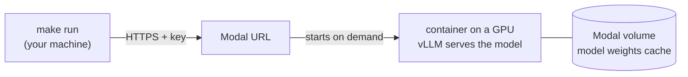

# Open models on Modal

This folder lets you run the study's games on an **open-weight model** (Qwen, Llama, gpt-oss, …)
hosted on [Modal](https://modal.com), a service that rents GPUs by the second. The environment talks
to it like to any OpenAI-compatible API. Nothing here is imported by the environment.

Tested end to end on 23 Oct 2026 with Qwen3-8B on one L40S (setup, security check, three studies).

**What Modal can and cannot run.** Modal runs models whose weights can be downloaded. It **cannot
run gpt-4.1-mini** (the paper's model): OpenAI never released its weights, so it is only reachable
through OpenAI's API, with an `OPENAI_API_KEY` (`configs/models/gpt-4.1-mini.yaml`).

## How it works, in one picture



- `modal deploy` builds an **image** (Ubuntu, CUDA, vLLM) and registers a permanent URL. No GPU
  runs and nothing is billed for GPU yet.
- The **first request** starts a **container** (a running copy of the image) on a GPU. vLLM loads the
  model and only then answers: about **2.5 minutes** when the weights are already cached, longer
  the very first time (Qwen3-8B: 16 GB to download into the Modal **volume**, a persistent disk).
- While requests arrive, the container stays up and answers fast.
- **15 minutes** after the last request, the container stops and billing stops ("scale to zero").

## What you need

- A Modal account. **Modal asks for a payment method before any GPU can be used**, even with free
  credits (checked on L40S, L4 and A10G). If you prefer, use a virtual card with a low limit. Check
  in Settings → Billing how credits and the card are used, and whether you can set a spending limit.
- The repo set up as in the main README (`make install`).

## One-time setup (per person, per Modal workspace)

```bash
cd collusion-env
uv tool install modal          # the `modal` command; not a dependency of the environment
                               # (pip install modal works too, except on NixOS)
modal setup                    # log in through the browser
```

If `modal: command not found`: `uv tool update-shell` and open a new terminal (or use `uvx modal …`).

**The API key.** It protects your endpoint: requests without it are refused. Create one key and
store it in two places, Modal (for the server) and `.env` (for your runs). `.env` is git-ignored.

```bash
KEY=$(python3 -c "import secrets; print(secrets.token_urlsafe(32))")
modal secret create collusion-vllm VLLM_API_KEY="$KEY"
echo "MODAL_VLLM_API_KEY=$KEY" >> .env
grep -c '^MODAL_VLLM_API_KEY=' .env     # must print 1 (the key on its own line)
```

Never paste the key in a chat, an issue or a commit.

## Deploy and check

```bash
modal deploy deploy/modal_vllm.py
```

It prints the URL, `https://<workspace>--collusion-vllm-server.<region>.modal.direct`. Put that URL
followed by `/v1` as `base_url` in your model file (see "Several people" below for which file).

```bash
make check-model MODEL=configs/models/modal-vllm.yaml
```

The check waits for the cold start (it prints a line every minute, up to 20 minutes), then sends one
game request and must end with `[ok] tool call: assign_task(...)` and `result : ready`.

**Security check, once after every deploy:** a request without the key must be refused.

```bash
curl -s -o /dev/null -w "%{http_code}\n" https://<your URL>/v1/models    # must print 401
```

`401` = the key is enforced. `200` = the endpoint is open: `modal app stop collusion-vllm` at once.
(`503` = still starting: retry after the check passes.)

## Run studies

Any study runs on the Modal model with `--use-model`; the run folder is named after the model.

```bash
make run STUDY=configs/studies/action_channel.yaml \
  ARGS='--use-model configs/models/modal-vllm.yaml --concurrency 16 --yes'
```

- `--yes`: Modal is a paid remote model, so runs ask for confirmation otherwise.
- `--concurrency`: episodes played at once. vLLM serves many requests in parallel; local studies
  default to 1, so raise it. 8–16 worked well on one L40S.
- Runs also wait for a cold start by themselves (`startup_wait_s` in the model file), and print
  `'<model>' is up` when the server answers.

Measured on 23 Oct (Qwen3-8B, one L40S, server already warm):

| Study | Episodes | Wall time | Tokens in / out |
|---|---|---|---|
| `modal_paper.yaml` (paper conditions, seeds 1–5) | 15 | 7 min (`--concurrency` 8) | 3.9 M / 77 k |
| `action_channel.yaml` (full size) | 120 | 1.5 min (16) | 0.9 M / 28 k |
| `local_team_three_games.yaml` (5 rounds per game) | 4 | 12.5 min (4) | 1.7 M / 37 k |

Long games are slow whatever the GPU: an episode plays its turns one after another, and team game 1
has 4 planning passes per round. The full `team_three_games.yaml` (20 rounds) would take about 50
minutes. Do several studies in one session, so you pay for one cold start.

## Stop and costs

```bash
modal app stop collusion-vllm      # stop now (otherwise: 15 idle minutes, billed)
modal app list                     # what is deployed
modal app logs collusion-vllm      # the server's log
```

`modal app stop` removes the deployment: next time, `modal deploy` again (a few seconds, the image is
cached) and expect a cold start. The app's page in the Modal dashboard shows whether a container is
running and what each session cost; note the cost of your runs there to plan bigger ones.

## Change the model

Settings are read from your shell when you deploy, and baked into the image. Redeploying replaces
the model behind the same URL.

| Variable | Default | Meaning |
|---|---|---|
| `MODEL` | `Qwen/Qwen3-8B` | Hugging Face model id |
| `MODEL_REVISION` | `main` | the model's commit: **pin it** for any run you report |
| `SERVED_NAME` | = `MODEL` | the name the API exposes (`model:` in the model file) |
| `TOOL_PARSER` | `hermes` | how vLLM reads tool calls: `hermes` for Qwen, `llama3_json` for Llama 3.x; other families: see vLLM's documentation |
| `REASONING_PARSER` | `qwen3` | separates "thinking" text; empty for models without it |
| `GPU` | `L40S:1` | Modal GPU type and count |
| `MAX_MODEL_LEN` | `16384` | context length; the longest prompt measured is 7,846 tokens (chat games) |
| `REGION` | `us-east` | where requests are routed |

Example (not tested here): `MODEL=Qwen/Qwen3-32B GPU=H100:1 modal deploy deploy/modal_vllm.py`.
Then update `model:` in the model file. Rough sizing: weights need about 2 GB per billion
parameters (8B: 16 GB on a 48 GB L40S; 32B: about 64 GB, so an 80 GB H100), plus room for the context.

- **Thinking.** Qwen3 thinks by default; `configs/models/modal-vllm.yaml` turns it off
  (`extra_body: {chat_template_kwargs: {enable_thinking: false}}`), like the local Qwen3-4B runs.
  Remove that line to turn it on, and raise `max_tokens`.
- **gpt-oss** (OpenAI's open models, 20b and 120b) can run here too, but they always reason before
  answering, unlike gpt-4.1-mini; their vLLM tool parser was not checked.
- A wrong tool parser shows up as turns without any tool call: `make check-model` fails, and runs
  show it in the health table.

## Several people

Two ways, both fine:

1. **Each person deploys in their own workspace.** Their URL differs: copy
   `configs/models/modal-vllm.yaml` to `configs/models/modal-<name>.yaml`, set your `base_url` and a
   distinct `label`, and use that file with `--use-model`. Each person pays for their own GPU.
2. **One shared endpoint.** The owner shares the key privately (a password manager, not Slack and
   not git); others put it in their `.env` as `MODAL_VLLM_API_KEY` and use the committed
   `configs/models/modal-vllm.yaml`. Runs from several people at once share one GPU (vLLM handles
   it, Modal may start a second container under heavy load).

The URL is in `configs/models/modal-vllm.yaml`, in the team's private repo. Keep it private: a request
without the key is refused, but it can still wake a GPU for 15 billed minutes.

## Security notes

- **"unauthenticated"** in the deploy output means Modal's own login check is off for this URL. The
  protection is vLLM's key check instead (the `curl` test above).
- **The key reaches vLLM through the `VLLM_API_KEY` environment variable** (the Modal secret), never
  as `--api-key`: vLLM prints its command-line arguments, key included, in its log. Check after a
  deploy: in `modal app logs collusion-vllm`, the `non-default args` line must not contain `api_key`.
- **Replacing the key** (if it leaked, or someone leaves the team):

  ```bash
  modal app stop collusion-vllm
  KEY=$(python3 -c "import secrets; print(secrets.token_urlsafe(32))")
  modal secret create collusion-vllm VLLM_API_KEY="$KEY" --force
  sed -i "s|^MODAL_VLLM_API_KEY=.*|MODAL_VLLM_API_KEY=$KEY|" .env
  modal deploy deploy/modal_vllm.py      # then the curl check again
  ```

## Troubleshooting

| Symptom | Cause | Fix |
|---|---|---|
| `Please add a payment method to use L40S GPU functions` | no card on the account | add one (see "What you need") |
| `HTTP 503 … no upstreams available` | the container is still starting | wait: `make check-model` and runs wait by themselves up to `startup_wait_s` |
| check fails after 20 min | the server crashed at start | `modal app logs collusion-vllm` (out of memory: smaller `MAX_MODEL_LEN` or a bigger GPU) |
| `HTTP 401` from `make check-model` | `.env` key ≠ Modal secret | redo the key steps |
| `curl` prints `200` | the key is not enforced | `modal app stop collusion-vllm`, then check the deploy file and logs |
| turns without tool calls | wrong `TOOL_PARSER` for the model family | redeploy with the right parser |
| `modal: command not found` | `~/.local/bin` not on PATH | `uv tool update-shell`, new terminal |

## Files

- `modal_vllm.py`: the Modal app (image, GPU, cache volumes, vLLM command).
- `../configs/models/modal-vllm.yaml`: how the environment calls it (URL, model name, key variable,
  thinking off, startup wait).
- `../configs/studies/modal_paper.yaml`: the local_paper boards on this model.
