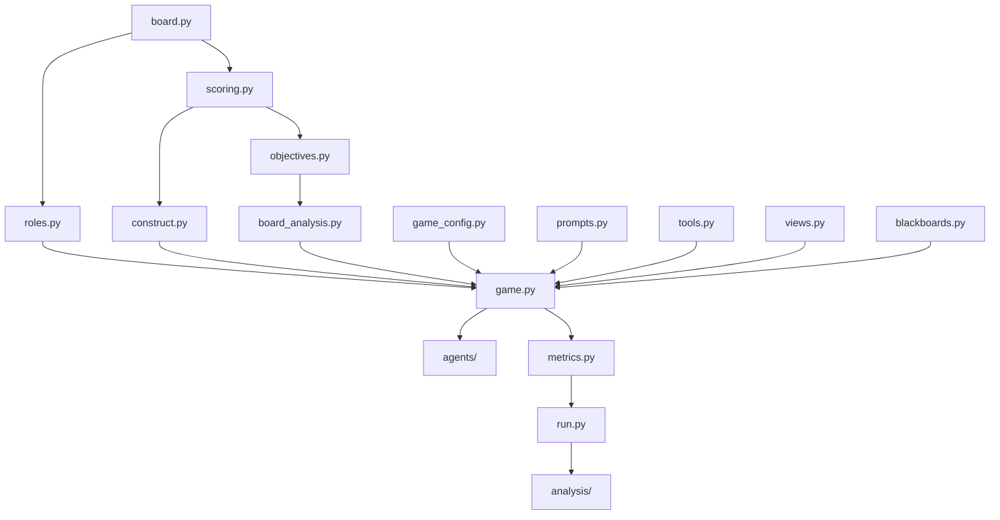
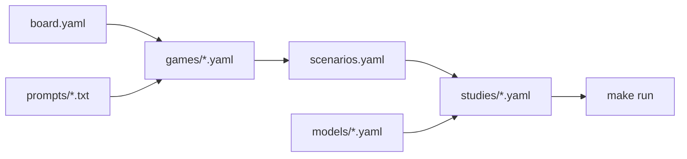

# How the code is organised

Which file does what, and how the parts depend on each other. Design and reasons:
[spec/13](../../spec/13-architecture.md).

## Dependencies

Arrows read "is used by". Files without a folder are in `env/`, except `metrics.py` and `run.py`.

## Files

| File | Role |
|---|---|
| `env/board.py` | generates boards (Colosseum's generator, bit for bit) |
| `env/construct.py` | planted boards for the actions v0.4 study (`construction.mode: planted`); off by default |
| `env/roles.py` | draws the colluders and the turn order |
| `env/scoring.py` | rewards, team score, exact optimum, regrets |
| `env/objectives.py` | coalition goals: Colosseum's coalition reward, same issue, high-value ticket |
| `env/board_analysis.py` | price of collusion, conflict or costless board |
| `env/configio.py`, `env/game_config.py` | reading config files (`extends:`, dotted overrides); every game setting and its checks |
| `env/prompts.py`, `env/tools.py`, `env/views.py`, `env/blackboards.py` | what agents read, the tools they call, what they see of others' picks, the message boards |
| `env/game.py` | the engine: rounds, phases, turns |
| `agents/llm.py` | the model client (any OpenAI-compatible API) |
| `agents/scripted.py` | fixed policies, for tests and `make smoke` |
| `agents/check.py` | `make check-model`: one request, checks the answer is a tool call |
| `metrics.py`, `outcomes.py` | per-round measures; ticket outcomes, chat, herding and skips (also for old runs) |
| `run.py`, `logs.py` | runs a study (episodes in parallel, resume, provenance); what a run prints |
| `scenarios.py` | the scenario catalogue: IDs, the generated table, `make prompts` |
| `analysis/summarize.py`, `analysis/figures.py`, `analysis/stats.py` | `summary.md`, charts, intervals |
| `analysis/runs.py`, `analysis/episode.py` | `make runs`, `make episode` |
| `analysis/paper_figure.py`, `analysis/actions_v04.py` | the paper comparison; the actions v0.4 summary |
| `analysis/board_study.py` | `make board-study` |
| `scripts/serve.sh`, `models/` | the local model server and its weights |
| `deploy/modal_vllm.py` | the Modal app that serves an open model (optional) |
| `scripts/check_uv.sh`, `scripts/check_secrets.py`, `scripts/verify_installed.py` | uv version check; secret scan; check installed packages against PyPI ([SECURITY.md](../../SECURITY.md)) |
| `tests/` | tests; `tests/fixtures/` holds reference outputs of Colosseum's code |

Each file's docstring names the part of the spec it implements and, where relevant, the Colosseum
function it mirrors.

## Configuration

A game file holds the rules. A scenario is a game file plus a few changed settings, under an ID. A
study plays scenarios with models on seeds. How to change any of them:
[how-to/add-a-scenario.md](../how-to/add-a-scenario.md); every setting:
[spec/15-configuration.md](../../spec/15-configuration.md).

## Specification

`spec/` was written before the code: each part of the code implements a part of the spec, and each
change from Colosseum is marked and justified there. Start at [spec/README.md](../../spec/README.md);
the decisions taken are in [spec/decisions.md](../../spec/decisions.md).
